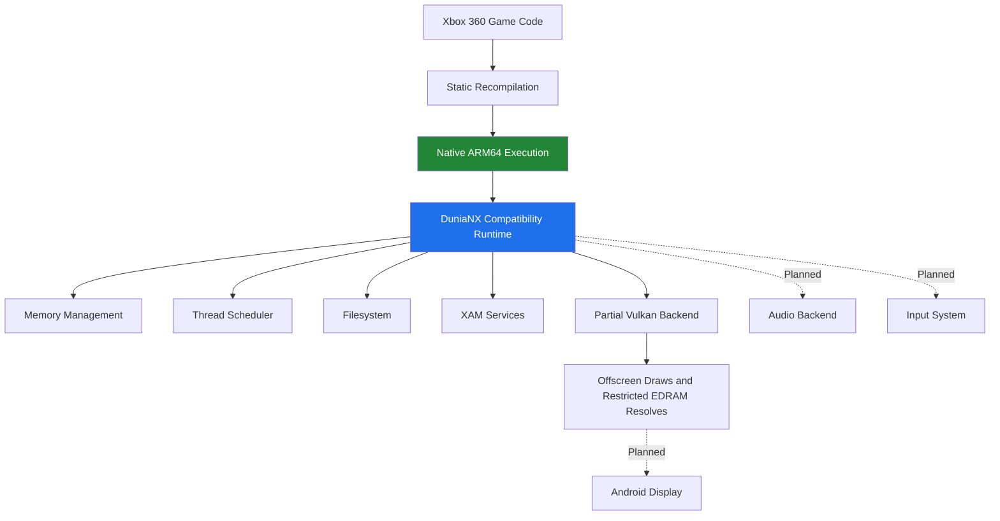

# DuniaNX

<div align="center">

# RECOMPILED. REBORN. NATIVE.

**Bringing Far Cry 2 to Android through native ARM64 recompilation.**


---

*The African wilderness. A new architecture. A new beginning.*

</div>

> [!IMPORTANT]
> **Still experimental; not playable.** The original Far Cry 2 executable
> executes via static PowerPC-to-ARM64 recompilation. A restricted Vulkan
> backend on a Mali-G57 MC2 GPU now renders and captures the **real game's
> animated loading indicator** in a Termux:X11 development viewer.
> This is *not* an integrated Android game swapchain or a completed main menu.
> The private signed Android diagnostic APK (v0.6-dev) is an earlier milestone;
> the latest Termux/X11 runtime changes have **not** been released as an APK.
> No public playable APK, game assets, or proprietary game code are distributed.

## About

DuniaNX is an independent experimental native Android port
project targeting the Xbox 360 version of Far Cry 2.

The project uses static recompilation to execute original
PowerPC game code on ARM64 processors, supported by a
custom Xbox 360 compatibility runtime.

Unlike traditional full-system emulation, DuniaNX aims
to execute recompiled game code directly on mobile hardware.

- Native ARM64 execution.
- Static PowerPC recompilation.
- Custom Xbox 360 compatibility runtime.
- Partial Vulkan graphics backend with verified original loading-frame capture.
- Mali-first development.
- No Windows compatibility layer.
- AI-assisted development.
- Developed entirely on an Android smartphone.

## Development Statistics

<div align="center">

| Component | Verified result |
|:---|---:|
| Statically recompiled game functions | **92,270** |
| Original platform imports mapped | **274** |
| Xenos shader programs translated to HLSL | **10,223** |
| Historical private Android APK v0.6-dev | **2,525,075 runtime imports** |
| Boot 264 (Termux/X11, completed at watchdog) | **216 frontbuffer snapshots / 147 distinct hashes** |
| Boot 266 (Termux/X11, completed at watchdog) | **247 snapshots / 158 distinct hashes** |
| Boot 266 original BC3 textured draws | **23,520** |
| Original UI shaders compared on actual draws (boot 263) | **16 draws; 68,252 / 68,252 pixels match** |
| Vulkan rectangle/depth integration validation | **11,293,560 checks passed** |
| Vulkan color-band validation | **923,052 checks passed** |
| Integrated game swapchain / main menu | **Not yet** |
| Public playable build | **Unavailable** |

</div>

Snapshot counts are from the original game's guest frontbuffer as decoded by
an **external X11 development capture viewer**. They are not native Android
presentation frames, unique render operations, or evidence of a playable menu.
Runtime import counts include repeated calls; test assertions are not FPS.
Boot 266 ended at the nine-minute watchdog without a new confirmed PM4 error.

## Latest Development Update

### November 20, 2026 — Native loading animation and Vulkan verification

DuniaNX has moved beyond the older `VdGetSystemCommandBuffer` startup
blocker. Original Xbox 360 GPU command buffers, the supported subset of
Xenos PM4 draws, EDRAM operations and `VdSwap` now drive an authentic
**animated Far Cry 2 loading indicator** rendered on the Mali-G57 MC2 GPU.
A development-only Termux:X11 viewer presents copies of captured game
frontbuffers; the game still has no integrated Android surface/swapchain.

### Verified milestones

- **Boot 263:** ran original translated UI vertex/pixel shaders in a second
  real Vulkan draw path for 16 captured UI draws. **All 68,252 tested pixels**
  exactly matched the existing restricted renderer. This validates only those
  captured draws, not every shader in the game.
- **Boot 264:** produced 216 genuine guest-frontbuffer snapshots (147 distinct
  hashes) and 20,592 BC3 draws; ended at the nine-minute watchdog without a
  newly confirmed GPU command failure. The loading phase did not complete.
- **Boot 265:** a CPU-thread execution stall after import 2,556,397; stopped
  manually for diagnosis. More import calls are *not* always more progress.
- **Boot 266:** recovered animated loading and continued beyond that stall.
  The completed watchdog run produced 247 snapshots and 23,520 BC3 draws.
  Native ARM64 PC sampling identified time spent in actual Vulkan rendering,
  frontbuffer snapshots and waits, instead of assuming a PM4 fault.
- **Readback optimization:** optional byte-complete row comparisons verified
  all original output bytes. Both optimized and baseline modes passed
  **11,293,560 rectangle/depth** and **923,052 color-band** checks.
  Persistent Vulkan pipeline objects and an exact-byte BC3 cache are also
  available behind experimental runtime flags.

These advances are from **local native test builds in Termux**, not the
previously device-tested private Android APK. The general-purpose GPU
translator, completed Dunia Engine initialization, native game swapchain,
main menu, audio and gameplay remain unfinished.

See the [detailed native-loading development log](devlogs/2026-11-20-native-loading.md)
and the [historical v0.6 Android preview log](devlogs/2026-11-20.md).

### Latest completed native diagnostic boot

```text
DuniaNX — Termux/X11 native boot 266 (540s watchdog)
==========================================================
Target................... Xbox 360 Far Cry 2
Native host.............. Android ARM64
GPU...................... Mali-G57 MC2 / real Vulkan
Runtime import calls..... 2,630,893
Guest frontbuffer copies. 247 (158 distinct hashes)
Original BC3 draws....... 23,520
Original UI shader proof. 16 draws / 68,252 exact pixels (boot 263)
Rectangle/depth tests.... 11,293,560 passed
Color-band tests......... 923,052 passed
X11 capture viewer....... Working (development only)
Integrated game surface.. Not implemented
Dunia initialization..... Incomplete
Main menu................ NOT REACHED
Gameplay................. NOT AVAILABLE
Public APK............... NOT AVAILABLE
==========================================================
```

Boot 267 is running separately as a new native readback-optimization test.
The numbers above are fixed observations from local logs, not live counters.
There is no verified gameplay FPS or completion percentage yet.

## Startup Evolution

| Milestone | Runtime Calls |
|:---|---:|
| First native execution | 2 |
| Early runtime implementation | 34 |
| Extended runtime compatibility | 7,561 |
| Network initialization | 7,607 |
| Direct I/O and scheduler improvements | 9,043 |
| Thread and XAM notification improvements | 23,228 |
| Extended native callback recovery (Nov 17) | 24,839 |
| Native boot 193 (Nov 19) | 2,544,008 |
| Android preview v0.6 (Nov 20) | **2,525,075** |
| Native boot 264 at watchdog (Nov 20) | **2,624,922** |
| Native boot 266 at watchdog (Nov 20) | **2,630,893** |

> [!NOTE]
> Runtime calls include repeated operations and vary with timing.
> They are not unique implemented functions, a measure of frame rate
> or a percentage of game completion. Progress is measured by
> verified behavior and the startup blockers resolved.

## Technical Architecture



## Development Roadmap

### Phase 01 — Static Recompilation

- [x] Original PowerPC executable analysis.
- [x] Static recompilation of over 92,000 functions.
- [x] Native ARM64 compilation.
- [x] Original game entry point execution.
- [x] Native instruction validation.

### Phase 02 — Compatibility Runtime

- [x] Initial Xbox 360 kernel compatibility.
- [x] Virtual memory management.
- [x] Physical memory management.
- [x] Original game resource access.
- [x] Direct disk I/O.
- [x] Cooperative thread scheduling.
- [x] Thread synchronization.
- [x] XAM notification queues.
- [x] Initial network compatibility.
- [x] Automated regression testing.
- [ ] Complete runtime compatibility.
- [ ] Complete Dunia Engine initialization.

### Phase 03 — Graphics

- [x] Original Xenos shader extraction.
- [x] Translation of 10,223 shaders to HLSL.
- [x] Restricted SPIR-V shader compilation and validation.
- [ ] Complete shader coverage and shader ABI verification.
- [x] Original UI shader differential validation on 16 captured draws.
- [ ] General shader behavior validation.
- [x] Initial Vulkan backend on real Mali hardware.
- [x] First original offscreen raster draw.
- [ ] General Vulkan graphics backend.
- [x] Initial GPU command processing.
- [ ] Complete GPU command processing.
- [x] Original texture decoding and GPU upload/readback.
- [ ] General texture management.
- [x] Restricted render-target and tiled EDRAM resolves.
- [ ] General render-target management.
- [x] Restricted system command buffer / `VdSwap` / frontbuffer handling.
- [ ] General GPU command and frontbuffer compatibility.
- [x] Development-only X11 viewer for captured guest frontbuffers.
- [ ] Integrated native Android Vulkan surface presentation.
- [ ] First presented full game frame.
- [ ] Main menu rendering.
- [x] Experimental Mali Vulkan pipeline reuse, BC3 cache, and readback verification.
- [ ] Gameplay-oriented GPU performance and compatibility optimization.

### Phase 04 — Gameplay

- [ ] Audio playback.
- [ ] Video playback.
- [ ] Touchscreen controls.
- [ ] Controller support.
- [ ] Save-game functionality.
- [ ] First playable gameplay.
- [ ] Performance optimization.
- [ ] Stability improvements.

### Phase 05 — Android Release

- [x] Native Android diagnostic launcher.
- [x] Original game file selection.
- [x] Initial game resource validation.
- [ ] Graphics configuration.
- [x] Signed Android diagnostic APK packaging.
- [x] Initial testing on one Mali Android device.
- [ ] Broader device compatibility testing.
- [ ] Public experimental release.

## Mali First

DuniaNX is being developed with mobile hardware
as its primary target.

Unlike workflows that prioritize desktop GPUs,
DuniaNX initially focuses on ARM64 Android devices
equipped with Mali graphics processors.

### Planned Graphics Features

- Full Vulkan rendering and display presentation.
- Mobile-oriented shader optimization.
- Configurable rendering resolution.
- Efficient memory management.
- Mobile-oriented graphics settings.
- Broader GPU compatibility.

Performance targets and minimum hardware requirements
will be established after full frame presentation and gameplay
become available.

Mali-first does not mean Mali-only.

## Built on Android, for Android

<div align="center">


</div>

DuniaNX is being developed, compiled and tested
entirely on an Android smartphone using Termux
and AI-assisted development tools.

No desktop computer is involved in the current
development workflow.

This project explores what modern mobile hardware
can achieve through static recompilation,
native execution and custom compatibility layers.

## Frequently Asked Questions

<details>
<summary><b>Does Far Cry 2 already run?</b></summary>

The original game code is executing natively on
ARM64 and accessing original game resources.

However, full engine initialization has not
yet been completed.

</details>

<details>
<summary><b>Is the game playable?</b></summary>

Not yet.

The project is currently focused on runtime
compatibility and original engine initialization.

</details>

<details>
<summary><b>Does it render graphics?</b></summary>

Yes, partially. Original in-game loading frames are captured from
the guest frontbuffer and shown in a separate Termux:X11 Vulkan viewer.
This is actual game output, **not** a fake menu, but not direct/native game
swapchain presentation either. The complete main menu remains pending.

</details>

<details>
<summary><b>Is DuniaNX an emulator?</b></summary>

DuniaNX uses static recompilation of the original PowerPC CPU code,
combined with a custom Xbox 360 compatibility runtime. Xenos GPU commands
are still translated to Vulkan at runtime, so **graphics compatibility
translation remains part of the architecture**, rather than a fully native
Dunia Engine Vulkan renderer. It is not full-system emulation.

</details>

<details>
<summary><b>Will Mali GPUs be supported?</b></summary>

Mali GPUs are the primary development target.

The partial backend has been tested on Mali-G57 MC2
with Vulkan 1.3.303. Wider compatibility is not established.

</details>

<details>
<summary><b>What about Adreno GPUs?</b></summary>

Broader Vulkan-compatible GPU support is planned.

</details>

<details>
<summary><b>Will I need the original game?</b></summary>

Yes.

Users will need their own legally obtained
copy of the original game.

</details>

<details>
<summary><b>Is there an APK available?</b></summary>

A private signed developer preview (v0.6-dev) has been
tested directly on Android. It is a diagnostic build, not
a playable port. No public playable APK is available.

</details>

<details>
<summary><b>Is the project open source?</b></summary>

This repository currently serves as the official
public development and announcement page.

Source code availability has not been announced.

</details>

<details>
<summary><b>What are the minimum requirements?</b></summary>

Minimum hardware requirements have not yet
been established.

Performance and compatibility testing will
determine the final requirements.

</details>

<details>
<summary><b>When will it be released?</b></summary>

When it's ready.

</details>

## Development Logs

This repository documents major development milestones,
runtime improvements, validation results and future
rendering progress.

- [November 20, 2026 — Native loading, original UI shaders, CPU/Vulkan profiling](devlogs/2026-11-20-native-loading.md)
- [November 20, 2026 — Historical Android v0.6 preview](devlogs/2026-11-20.md)
- [November 17, 2026 — early runtime milestone](devlogs/2026-11-17.md)

Development reports reflect the current state
of the project and do not imply complete
game compatibility.

## Follow the Development

Interested in the future of native Android gaming?

- Star this repository.
- Watch for development updates.
- Follow technical milestones.
- Stay tuned for rendering demonstrations.

<div align="center">

[](https://github.com/mexicanbr0auth/DuniaNX)

</div>

## Disclaimer

DuniaNX is an independent, unofficial experimental
project.

It is not affiliated with, endorsed by or sponsored
by Ubisoft, Microsoft or Arm.

Far Cry 2, Dunia Engine, Xbox 360 and all associated
trademarks and copyrighted materials belong to
their respective owners.

No proprietary game assets or original game
executables are distributed through this repository.

Users are responsible for obtaining their own
legal copy of the original game.

---

<div align="center">

### Original Loading Frames. Native ARM64. The Journey Continues.


*From PowerPC to ARM64.*

*From console to smartphone.*

*The journey has already begun.*

**DuniaNX — Stay tuned.**

</div>
