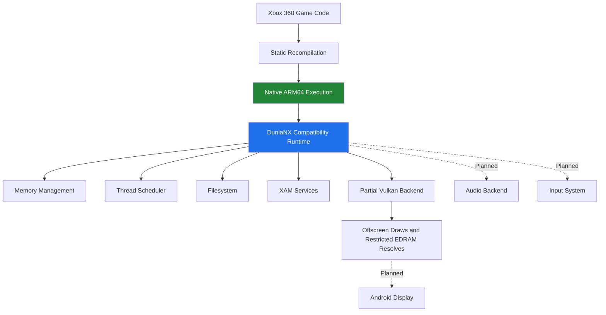

# DuniaNX

<div align="center">

# RECOMPILED. REBORN. NATIVE.

**Bringing Far Cry 2 to Android through native ARM64 recompilation.**


---

*The African wilderness. A new architecture. A new beginning.*

</div>

> [!IMPORTANT]
> DuniaNX is currently under active development.
> Original game code is already executing natively on ARM64.
> Original startup draw commands now execute offscreen through Vulkan.
> A private Android developer preview has been tested on real Mali hardware.
> No complete game frame, main menu or gameplay has been achieved.
> No public playable APK is currently available.

## About

DuniaNX is an independent experimental native Android port
project targeting the Xbox 360 version of Far Cry 2.

The project uses static recompilation to execute original
PowerPC game code on ARM64 processors, supported by a
custom Xbox 360 compatibility runtime.

Unlike traditional full-system emulation, DuniaNX aims
to execute recompiled game code directly on mobile hardware.

- Native ARM64 execution.
- Static PowerPC recompilation.
- Custom Xbox 360 compatibility runtime.
- Partial Vulkan graphics backend with verified offscreen rendering.
- Mali-first development.
- No Windows compatibility layer.
- AI-assisted development.
- Developed entirely on an Android smartphone.

## Development Statistics

<div align="center">

| Component | Result |
|:---|---:|
| Recompiled game functions | **92,270** |
| Original platform imports | **274** |
| Shaders translated to HLSL | **10,223** |
| Startup calls in Android preview v0.6 | **2,525,075** |
| GPU command ring submissions completed | **15** |
| GPU packets processed | **948** |
| Original offscreen draws executed | **5** |
| EDRAM resolves completed | **4** |
| Shader load operations | **20** |
| Latest graphics integration checks | **4,963,744 passed** |
| First presented game frame | Pending (0) |
| Private Android diagnostic APK | **v0.6-dev — device-tested** |
| Public playable build | Unavailable |

</div>

## Latest Development Update

### November 20, 2026

DuniaNX now executes over **2.5 million runtime import calls**
inside a standalone Android application, with a partial Vulkan
backend running on a Mali-G57 MC2 GPU (Vulkan 1.3.303).

Developer Preview v0.6 reproduces the latest native startup
milestone (boot 193) outside Termux. Both EDRAM rendering bins
complete their original command sequences.

### Recent Achievements

- Original Xenos command processing, including indirect buffers and bin predicates.
- Verified Vulkan offscreen rasterization of original startup rectangle draws.
- Restricted color, depth and stencil handling, including 4x MSAA.
- Four EDRAM resolves with 2x MSAA source layout: constrained uniform data copied into guest tiled textures.
- Left and right halves of a 1280 × 696 texture covered by the resolve path.
- Original BC1 texture decoding, Vulkan upload and verified 65,536-byte readback (128 × 128 RGBA).
- Signed ARM64 diagnostic APK, tested on the Android device with user-provided game files.
- 4,963,744 graphics integration checks passed, including pixel, address and memory assertions.

The current startup stops at the unimplemented
`VdGetSystemCommandBuffer` import. The next objective is
system command buffer support, frontbuffer handling and
the presentation path through `VdSwap`.

### Current Validation Summary

```text
DuniaNX Developer Preview v0.6-dev
========================================
Architecture............. ARM64
Target Platform.......... Android
Original Platform........ Xbox 360
GPU...................... Mali-G57 MC2
Vulkan API............... 1.3.303

Startup Import Calls..... 2525075
Completed Rings.......... 15
GPU Packets.............. 948
Offscreen Draws.......... 5
EDRAM Resolves........... 4
Shader Loads............. 20
Inert Draws.............. 24
Presented Game Frames.... 0

Graphics Integration..... 4963744 checks passed
Full Regression.......... RE-RUN PENDING

Current Blocker.......... VdGetSystemCommandBuffer
Engine Initialization.... IN PROGRESS
Main Menu................ NOT REACHED
Gameplay................. NOT AVAILABLE
========================================
```

The runtime figures above are from the device-tested Android
preview. Integration checks are from separate local tests,
not millions of completed renders. The last full regression
pass predates these graphics changes; a new full run is pending.

Read the [November 20 development log](devlogs/2026-11-20.md)
for further details.

## Startup Evolution

| Milestone | Runtime Calls |
|:---|---:|
| First native execution | 2 |
| Early runtime implementation | 34 |
| Extended runtime compatibility | 7,561 |
| Network initialization | 7,607 |
| Direct I/O and scheduler improvements | 9,043 |
| Thread and XAM notification improvements | 23,228 |
| Extended native callback recovery (Nov 17) | 24,839 |
| Native boot 193 (Nov 19) | 2,544,008 |
| Android preview v0.6 (Nov 20) | **2,525,075** |

> [!NOTE]
> Runtime calls include repeated operations and vary with timing.
> They are not unique implemented functions, a measure of frame rate
> or a percentage of game completion. Progress is measured by
> verified behavior and the startup blockers resolved.

## Technical Architecture



## Development Roadmap

### Phase 01 — Static Recompilation

- [x] Original PowerPC executable analysis.
- [x] Static recompilation of over 92,000 functions.
- [x] Native ARM64 compilation.
- [x] Original game entry point execution.
- [x] Native instruction validation.

### Phase 02 — Compatibility Runtime

- [x] Initial Xbox 360 kernel compatibility.
- [x] Virtual memory management.
- [x] Physical memory management.
- [x] Original game resource access.
- [x] Direct disk I/O.
- [x] Cooperative thread scheduling.
- [x] Thread synchronization.
- [x] XAM notification queues.
- [x] Initial network compatibility.
- [x] Automated regression testing.
- [ ] Complete runtime compatibility.
- [ ] Complete Dunia Engine initialization.

### Phase 03 — Graphics

- [x] Original Xenos shader extraction.
- [x] Translation of 10,223 shaders to HLSL.
- [ ] SPIR-V shader compilation.
- [ ] Shader behavior validation.
- [x] Initial Vulkan backend on real Mali hardware.
- [x] First original offscreen raster draw.
- [ ] General Vulkan graphics backend.
- [x] Initial GPU command processing.
- [ ] Complete GPU command processing.
- [x] Original texture decoding and GPU upload/readback.
- [ ] General texture management.
- [x] Restricted render-target and tiled EDRAM resolves.
- [ ] General render-target management.
- [ ] System command buffer and frontbuffer handling.
- [ ] Vulkan surface presentation.
- [ ] First presented full game frame.
- [ ] Main menu rendering.
- [ ] Mali GPU optimization.

### Phase 04 — Gameplay

- [ ] Audio playback.
- [ ] Video playback.
- [ ] Touchscreen controls.
- [ ] Controller support.
- [ ] Save-game functionality.
- [ ] First playable gameplay.
- [ ] Performance optimization.
- [ ] Stability improvements.

### Phase 05 — Android Release

- [x] Native Android diagnostic launcher.
- [x] Original game file selection.
- [x] Initial game resource validation.
- [ ] Graphics configuration.
- [x] Signed Android diagnostic APK packaging.
- [x] Initial testing on one Mali Android device.
- [ ] Broader device compatibility testing.
- [ ] Public experimental release.

## Mali First

DuniaNX is being developed with mobile hardware
as its primary target.

Unlike workflows that prioritize desktop GPUs,
DuniaNX initially focuses on ARM64 Android devices
equipped with Mali graphics processors.

### Planned Graphics Features

- Full Vulkan rendering and display presentation.
- Mobile-oriented shader optimization.
- Configurable rendering resolution.
- Efficient memory management.
- Mobile-oriented graphics settings.
- Broader GPU compatibility.

Performance targets and minimum hardware requirements
will be established after full frame presentation and gameplay
become available.

Mali-first does not mean Mali-only.

## Built on Android, for Android

<div align="center">


</div>

DuniaNX is being developed, compiled and tested
entirely on an Android smartphone using Termux
and AI-assisted development tools.

No desktop computer is involved in the current
development workflow.

This project explores what modern mobile hardware
can achieve through static recompilation,
native execution and custom compatibility layers.

## Frequently Asked Questions

<details>
<summary><b>Does Far Cry 2 already run?</b></summary>

The original game code is executing natively on
ARM64 and accessing original game resources.

However, full engine initialization has not
yet been completed.

</details>

<details>
<summary><b>Is the game playable?</b></summary>

Not yet.

The project is currently focused on runtime
compatibility and original engine initialization.

</details>

<details>
<summary><b>Does it render graphics?</b></summary>

Partially. Original startup rectangle commands are executed
offscreen on Vulkan, and restricted EDRAM resolves are working.
The texture diagnostic is not a game frame.
A complete presented frame and the main menu are still pending.

</details>

<details>
<summary><b>Is DuniaNX an emulator?</b></summary>

DuniaNX uses static recompilation combined with
a custom Xbox 360 compatibility runtime instead
of traditional full-system emulation.

</details>

<details>
<summary><b>Will Mali GPUs be supported?</b></summary>

Mali GPUs are the primary development target.

The partial backend has been tested on Mali-G57 MC2
with Vulkan 1.3.303. Wider compatibility is not established.

</details>

<details>
<summary><b>What about Adreno GPUs?</b></summary>

Broader Vulkan-compatible GPU support is planned.

</details>

<details>
<summary><b>Will I need the original game?</b></summary>

Yes.

Users will need their own legally obtained
copy of the original game.

</details>

<details>
<summary><b>Is there an APK available?</b></summary>

A private signed developer preview (v0.6-dev) has been
tested directly on Android. It is a diagnostic build, not
a playable port. No public playable APK is available.

</details>

<details>
<summary><b>Is the project open source?</b></summary>

This repository currently serves as the official
public development and announcement page.

Source code availability has not been announced.

</details>

<details>
<summary><b>What are the minimum requirements?</b></summary>

Minimum hardware requirements have not yet
been established.

Performance and compatibility testing will
determine the final requirements.

</details>

<details>
<summary><b>When will it be released?</b></summary>

When it's ready.

</details>

## Development Logs

This repository documents major development milestones,
runtime improvements, validation results and future
rendering progress.

- [November 20, 2026 — Android preview and Vulkan progress](devlogs/2026-11-20.md)
- [November 17, 2026 — early runtime milestone](devlogs/2026-11-17.md)

Development reports reflect the current state
of the project and do not imply complete
game compatibility.

## Follow the Development

Interested in the future of native Android gaming?

- Star this repository.
- Watch for development updates.
- Follow technical milestones.
- Stay tuned for rendering demonstrations.

<div align="center">

[](https://github.com/mexicanbr0auth/DuniaNX)

</div>

## Disclaimer

DuniaNX is an independent, unofficial experimental
project.

It is not affiliated with, endorsed by or sponsored
by Ubisoft, Microsoft or Arm.

Far Cry 2, Dunia Engine, Xbox 360 and all associated
trademarks and copyrighted materials belong to
their respective owners.

No proprietary game assets or original game
executables are distributed through this repository.

Users are responsible for obtaining their own
legal copy of the original game.

---

<div align="center">

### 2.5 Million Calls. One Step Closer.


*From PowerPC to ARM64.*

*From console to smartphone.*

*The journey has already begun.*

**DuniaNX — Stay tuned.**

</div>
