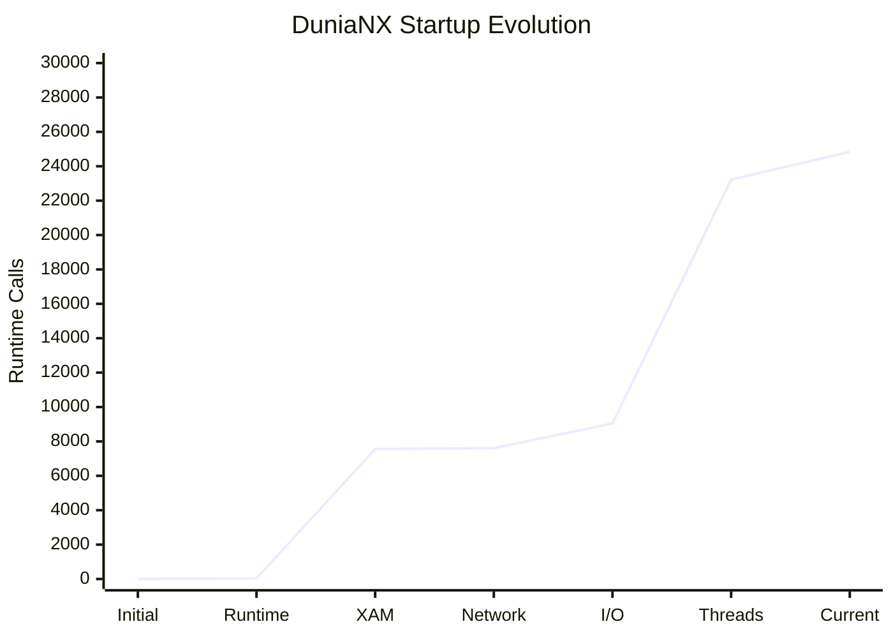
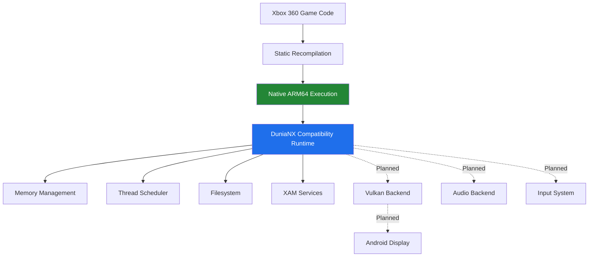

# DuniaNX

<div align="center">

# RECOMPILED. REBORN. NATIVE.

**Bringing Far Cry 2 to Android through native ARM64 recompilation.**


---

*The African wilderness. A new architecture. A new beginning.*

</div>

> [!IMPORTANT]
> DuniaNX is currently under active development.
> Original game code is already executing natively on ARM64.
> Full boot, rendering and gameplay have not yet been achieved.
> No public playable APK is currently available.

## About

DuniaNX is an independent experimental native Android port
project targeting the Xbox 360 version of Far Cry 2.

The project uses static recompilation to execute original
PowerPC game code on ARM64 processors, supported by a
custom Xbox 360 compatibility runtime.

Unlike traditional full-system emulation, DuniaNX aims
to execute recompiled game code directly on mobile hardware.

- Native ARM64 execution.
- Static PowerPC recompilation.
- Custom Xbox 360 compatibility runtime.
- Planned Vulkan graphics backend.
- Mali-first development.
- No Windows compatibility layer.
- AI-assisted development.
- Developed entirely on an Android smartphone.

## Development Statistics

<div align="center">

| Component | Result |
|:---|---:|
| Recompiled game functions | **92,270** |
| Original platform imports | **274** |
| Shaders translated to HLSL | **10,223** |
| Startup import calls reached | **24,839** |
| Latest native verification checks | **19,485 passed** |
| Thread verification checks | **124 passed** |
| Notification verification checks | **41 passed** |
| Full local regression suite | **PASSED** |
| First rendered frame | Pending |
| Playable build | Unavailable |

</div>

## Latest Development Update

### November 17, 2026

The original game startup has advanced to
**24,839 import calls** on native ARM64.

Recent development has focused on recovering original
game callbacks, improving runtime compatibility and
validating native execution.

### Recent Achievements

- Recovered native field-access callbacks.
- Recovered string-related callbacks.
- Recovered indexed-access callbacks.
- Fixed incorrect interruption of infinite waits.
- Implemented functional XAM notification queues.
- Improved thread synchronization.
- Improved filesystem compatibility.
- Implemented aligned direct disk I/O.
- Passed 19,485 native verification checks.
- Passed the complete local regression suite.

### Current Validation Summary

```text
DuniaNX Native Runtime
========================================
Architecture............. ARM64
Target Platform.......... Android
Original Platform........ Xbox 360
GPU Priority............. Mali

Recompiled Functions..... 92270
Translated Shaders....... 10223
Startup Import Calls..... 24839

Native Checks............ 19485 PASSED
Thread Checks............ 124 PASSED
Notification Checks...... 41 PASSED

Filesystem Tests......... PASSED
Callback Tests........... PASSED
Thread Tests............. PASSED
Notification Tests....... PASSED
Full Regression.......... PASSED

Engine Initialization.... IN PROGRESS
Full Game Boot........... NOT REACHED
Graphics Rendering....... NOT REACHED
Gameplay................. NOT AVAILABLE

Status................... ACTIVE DEVELOPMENT
========================================
```

This is a development report summary, not an unmodified
terminal capture.

## Startup Evolution

| Milestone | Runtime Calls |
|:---|---:|
| First native execution | 2 |
| Early runtime implementation | 34 |
| Extended runtime compatibility | 7,561 |
| Network initialization | 7,607 |
| Direct I/O and scheduler improvements | 9,043 |
| Thread and XAM notification improvements | 23,228 |
| Extended native callback recovery | **24,839** |



> [!NOTE]
> Runtime calls include repeated operations.
> These numbers do not represent unique implemented
> functions or a percentage of game completion.

## Technical Architecture



## Development Roadmap

### Phase 01 — Static Recompilation

- [x] Original PowerPC executable analysis.
- [x] Static recompilation of over 92,000 functions.
- [x] Native ARM64 compilation.
- [x] Original game entry point execution.
- [x] Native instruction validation.

### Phase 02 — Compatibility Runtime

- [x] Initial Xbox 360 kernel compatibility.
- [x] Virtual memory management.
- [x] Physical memory management.
- [x] Original game resource access.
- [x] Direct disk I/O.
- [x] Cooperative thread scheduling.
- [x] Thread synchronization.
- [x] XAM notification queues.
- [x] Initial network compatibility.
- [x] Automated regression testing.
- [ ] Complete runtime compatibility.
- [ ] Complete Dunia Engine initialization.

### Phase 03 — Graphics

- [x] Original Xenos shader extraction.
- [x] Translation of 10,223 shaders to HLSL.
- [ ] SPIR-V shader compilation.
- [ ] Shader behavior validation.
- [ ] Vulkan graphics backend.
- [ ] GPU command processing.
- [ ] Texture management.
- [ ] Render-target management.
- [ ] First rendered frame.
- [ ] Main menu rendering.
- [ ] Mali GPU optimization.

### Phase 04 — Gameplay

- [ ] Audio playback.
- [ ] Video playback.
- [ ] Touchscreen controls.
- [ ] Controller support.
- [ ] Save-game functionality.
- [ ] First playable gameplay.
- [ ] Performance optimization.
- [ ] Stability improvements.

### Phase 05 — Android Release

- [ ] Native Android launcher.
- [ ] Original game file selection.
- [ ] Game resource validation.
- [ ] Graphics configuration.
- [ ] Android APK packaging.
- [ ] Device compatibility testing.
- [ ] Public experimental release.

## Mali First

DuniaNX is being developed with mobile hardware
as its primary target.

Unlike workflows that prioritize desktop GPUs,
DuniaNX initially focuses on ARM64 Android devices
equipped with Mali graphics processors.

### Planned Graphics Features

- Vulkan rendering.
- Mobile-oriented shader optimization.
- Configurable rendering resolution.
- Efficient memory management.
- Mobile-oriented graphics settings.
- Broader GPU compatibility.

Performance targets and minimum hardware requirements
will be established after rendering and gameplay
become available.

Mali-first does not mean Mali-only.

## Built on Android, for Android

<div align="center">


</div>

DuniaNX is being developed, compiled and tested
entirely on an Android smartphone using Termux
and AI-assisted development tools.

No desktop computer is involved in the current
development workflow.

This project explores what modern mobile hardware
can achieve through static recompilation,
native execution and custom compatibility layers.

## Frequently Asked Questions

<details>
<summary><b>Does Far Cry 2 already run?</b></summary>

The original game code is executing natively on
ARM64 and accessing original game resources.

However, full engine initialization has not
yet been completed.

</details>

<details>
<summary><b>Is the game playable?</b></summary>

Not yet.

The project is currently focused on runtime
compatibility and original engine initialization.

</details>

<details>
<summary><b>Does it render graphics?</b></summary>

Not yet.

The first rendered frame remains one of the most
important upcoming milestones.

</details>

<details>
<summary><b>Is DuniaNX an emulator?</b></summary>

DuniaNX uses static recompilation combined with
a custom Xbox 360 compatibility runtime instead
of traditional full-system emulation.

</details>

<details>
<summary><b>Will Mali GPUs be supported?</b></summary>

Mali GPUs are the primary development target.

Actual compatibility will be established through
testing once the graphics backend is operational.

</details>

<details>
<summary><b>What about Adreno GPUs?</b></summary>

Broader Vulkan-compatible GPU support is planned.

</details>

<details>
<summary><b>Will I need the original game?</b></summary>

Yes.

Users will need their own legally obtained
copy of the original game.

</details>

<details>
<summary><b>Is there an APK available?</b></summary>

No public playable APK is currently available.

</details>

<details>
<summary><b>Is the project open source?</b></summary>

This repository currently serves as the official
public development and announcement page.

Source code availability has not been announced.

</details>

<details>
<summary><b>What are the minimum requirements?</b></summary>

Minimum hardware requirements have not yet
been established.

Performance and compatibility testing will
determine the final requirements.

</details>

<details>
<summary><b>When will it be released?</b></summary>

When it's ready.

</details>

## Development Logs

This repository documents major development milestones,
runtime improvements, validation results and future
rendering progress.

Development reports reflect the current state
of the project and do not imply complete
game compatibility.

## Follow the Development

Interested in the future of native Android gaming?

- Star this repository.
- Watch for development updates.
- Follow technical milestones.
- Stay tuned for rendering demonstrations.

<div align="center">

[](https://github.com/mexicanbr0auth/DuniaNX)

</div>

## Disclaimer

DuniaNX is an independent, unofficial experimental
project.

It is not affiliated with, endorsed by or sponsored
by Ubisoft, Microsoft or Arm.

Far Cry 2, Dunia Engine, Xbox 360 and all associated
trademarks and copyrighted materials belong to
their respective owners.

No proprietary game assets or original game
executables are distributed through this repository.

Users are responsible for obtaining their own
legal copy of the original game.

---

<div align="center">

### 24,839 Calls. One Step Closer.


*From PowerPC to ARM64.*

*From console to smartphone.*

*The journey has already begun.*

**DuniaNX — Stay tuned.**

</div>
